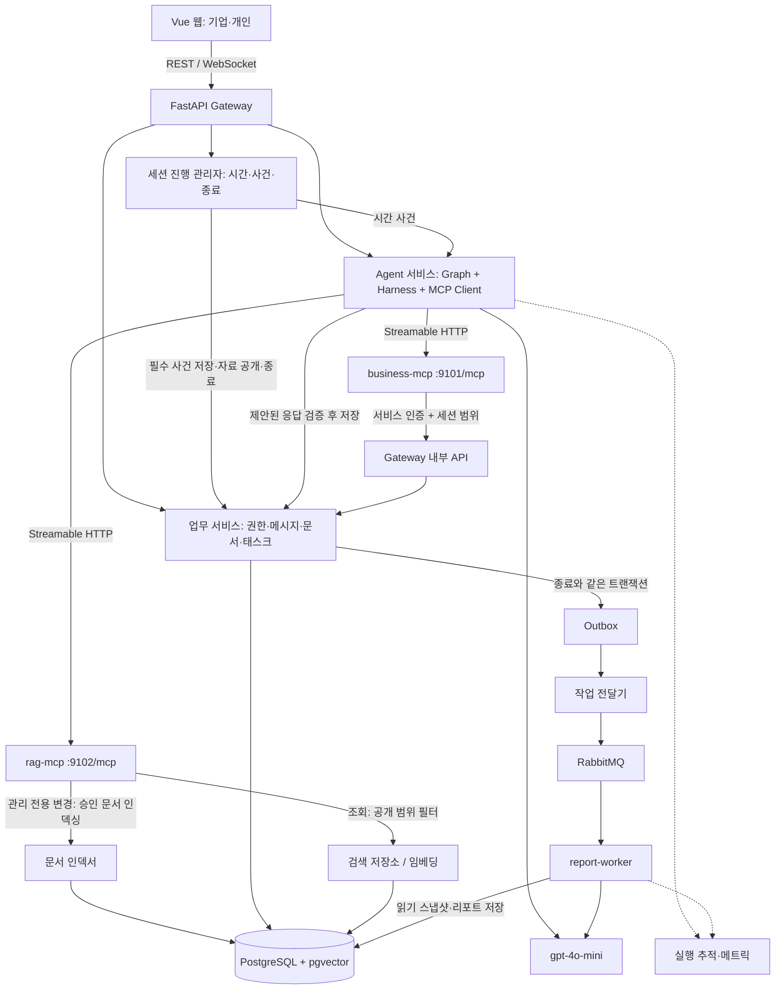
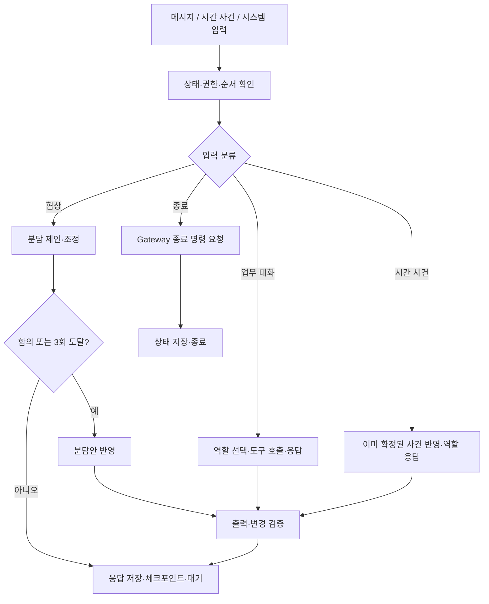

# Day Zero — MVP 시스템·에이전트 설계도

작성일: 2026-10-20  
기준: `PRD.md` 최종본, 대화에서 합의한 MVP·확장 범위, 사용자가 제공한 팀별 Capstone 평가표  
상태: 공통 기능과 시나리오 3종 v1 구현 진행 중. 아래는 전체 설계 기준이며 항목별 실제 구현·검증 상태는 `docs/implementation-status.md`를 따른다.

> **2026-10-20 후속 합의:** 사용자가 시나리오 상세 구현을 승인했다. 실행 설정은 `scenarios/versions/S01-v1.json`~`S03-v1.json`, 시간표·관찰 한계는 `docs/scenarios-v1.md`를 따른다. 기본 120분의 정시 직원 메시지와 공개 자료, 팀장·동료의 사건별 응답 정보가 연결된다. 리포트 v1은 활동 근거 연결이다. 후속 사용자 요청으로 v2에는 최종 제출물 검토와 역량별 짧은 AI 해석을 추가한다. 점수·채용 판정·성격 단정은 생성하지 않는다. 시나리오별 지원 역량 5개를 유지하며 6개 전체 선택 시 일반 시나리오는 없다. 기존 프로젝트의 버전은 유지한다.

> **최신 범위:** 기업은 역량 6개 중 3~6개를 선택하고 가능한 발행 시나리오 하나로 프로젝트를 생성한다. 프론트는 Vue, 기업·개인은 각각 로그인한다. PRD의 이전 단일 시나리오 관련 내용과 충돌하면 이 문서와 시나리오 v1 명세의 최신 합의를 따른다.

## 1. 목표와 범위

지원자가 AI 동료·팀장과 가상 업무를 하고 AI 어시스턴트를 활용하는 과정을 기록한다. 기업에는 선택된 관찰 항목별 상황·행동·원문 근거를 제공한다. 점수·순위·합격 판정과 성격 단정은 생성하지 않는다.

### 1.1 MVP

- 시나리오와 분리된 공통 응시 엔진을 먼저 구현한다. 시나리오 3종 v1의 실제 과제·자료·사건·제출물은 버전 설정으로 주입한다.
- AI 동료·팀장과 별도 창의 업무용 AI 어시스턴트. 등장인물의 이름·페르소나는 시나리오 설정에서 주입한다.
- PRD 5.3의 역량 6개 중 기업이 3~6개 선택. 해당 역량 전체를 지원하는 시나리오 하나로 프로젝트를 생성한다.
- 메신저(팀 채널·동료 DM), 과제 문서, 태스크 보드, 회사 문서 열람. 문서 항목·태스크 수·기본 담당자는 시나리오 설정을 따른다.
- Vue 기반 기업·개인 로그인, 프로젝트 생성·지원자 초대, 안내·동의, 응시·제출·완료 표시, 디브리핑, 기업의 개인별 비동기 리포트 확인.
- State·Graph 기반 에이전트, **business-mcp와 rag-mcp 서버 2개**, Harness, 작업 큐.
- LLM은 PRD 제약에 따라 `gpt-4o-mini`만 사용한다.
- 사전 인적성 검사와의 비교·기업의 시나리오 편집 화면은 포함하지 않는다. 역량·시나리오 선택 화면은 MVP에 포함한다.
- 브라우저 이어하기 UX·무응답 확인·회사 문서 관리 화면·근거 원문 이동은 PRD의 P1이다. 다만 평가표의 상태 저장·재개를 입증할 **Graph 체크포인트 복구**와 MCP 변경·Harness 사람 승인을 입증할 **최소 문서 등록·승인 API**는 기술 시연 필수 범위로 구현한다. 기업용 문서 편집 제품 화면까지 확대하지 않는다.

### 1.2 시나리오 선택과 향후 확장

기업이 역량을 선택하면 해당 역량을 관찰할 수 있는 시나리오 목록을 보여 주고, **그중 하나를 선택해 평가**한다. 기업이 사건이나 시나리오를 직접 편집하는 기능은 현재 확장 합의에도 포함하지 않는다.

MVP부터 시나리오·역량·관찰 기준을 데이터로 분리하고 버전을 둔다. 같은 평가에 속한 지원자들은 동일한 시나리오·자료·관찰 기준 버전을 사용한다. 진행 중인 세션의 설정을 수정하지 않는다.

MVP부터 시나리오 목록은 선택한 역량 전체를 관찰할 수 있는 발행 버전으로 제한한다. 해당 조합을 지원하는 시나리오가 없으면 지원하지 않는 조합임을 안내하고, 여러 시나리오를 임의로 합치거나 관찰 기회가 없는 역량의 리포트를 만들지 않는다. 시나리오 3종 v1의 구체 내용과 지원 역량 매핑은 `docs/scenarios-v1.md`를 따른다.

### 1.3 역량·프로젝트 계약

기업의 **평가 프로젝트(project)**는 선택 역량·시나리오·초대 지원자·개인별 리포트를 묶는 단위다. 기업 내부의 하나의 평가 단위이며 구현 명칭은 `projects`, `project_id`로 통일한다.

| ID | 선택 역량 |
|---|---|
| C01 | 의사소통·요구 파악 |
| C02 | 협업·갈등 조율 |
| C03 | 책임 이행·일정 관리 |
| C04 | 문제 해결·우선순위 판단 |
| C05 | 변화 대응·피드백 수용 |
| C06 | 비판적 검토·AI 활용 |

- `3 <= len(competency_ids) <= 6`과 ID 중복 없음·등록 여부를 서버에서 검사한다. 중복을 제거한 뒤 조용히 통과시키지 않는다.
- 선택 역량 집합이 시나리오 지원 역량 집합의 부분집합이어야 한다. 시나리오 매핑에는 역량별 관찰 기회·규칙 버전이 있어야 하며 단순 이름 태그만으로 지원을 인정하지 않는다.
- 시나리오 목록 조회와 프로젝트 생성 시 모두 같은 검증을 실행한다. 발행 취소·버전 변경·다른 기업 전용 시나리오 접근도 생성 시 재검사한다.
- 지원 가능한 시나리오가 없으면 결과 없음 상태로 반환하고 프로젝트 생성은 거절한다. 실제 관찰 기회가 없는 역량을 지원한다고 가정하지 않는다.
- 생성 시 역량·시나리오·관찰 규칙 버전을 고정하고 생성 요청 ID로 중복 생성을 방지한다. 지원자 초대·응시·리포트에는 `project_id`를 연결한다.
- 리포트 항목은 선택된 3~6개만 생성하고 관찰 없음도 표시한다. C06 미선택 시 별도의 AI 활용 평가 항목을 추가하지 않는다.
- 권한·기록 수집 동의·사건 시간표는 선택 역량 수에 따라 암묵적으로 달라지지 않는다. 시나리오의 공통 사건은 유지하고 해석·리포트 항목을 선택 역량으로 제한한다.

제안 API: `GET /competencies`, `POST /scenario-options`(선택 ID로 조회), `POST /projects`(역량 ID·시나리오 버전·생성 요청 ID), `POST /projects/{id}/invitations`, `GET /projects/{id}/candidates`. 기업은 선택한 역량·시나리오로 프로젝트를 생성하며 서버가 기본 시나리오를 임의로 배정하지 않는다.

검증 경계: 2개 선택 거절, 3개·6개 허용(지원 시나리오 존재 시), 중복·미등록·7개 이상 거절, 일부만 지원하는 시나리오 제외, 결과 없음, 다른 기업 접근 차단, 생성 후 버전 유지, 선택 역량만 리포트에 포함.

### 1.4 시나리오 목록 — v1 발행

| 계열 ID | 시나리오 |
|---|---|
| S01 | 신규 기능 개선안 기획 |
| S02 | 서비스 장애·고객 불만 대응 |
| S03 | 출시 준비·팀 업무 조율 |

`S01-v1`~`S03-v1`의 실행 설정에 가상 회사·과제·인물·정시 개입·자료·제출물·지원 역량·활동 근거 규칙을 정의한다. 상세와 시간표는 `docs/scenarios-v1.md`를 따른다. 계열 이름만 있는 과거 초안 ID는 프로젝트 생성에 사용하지 않는다.

### 1.5 시나리오와 공통 기능의 분리

- 공통 엔진은 인증·프로젝트·초대·응시, 메신저·문서·태스크·어시스턴트, MCP 연결, 기록·제출·리포트 작업 처리를 담당한다.
- 시나리오는 `과제 + 역할 지침 + 사내 문서 참조 + 문서·태스크 양식 + 사건 설정 + 지원 역량·관찰 기준`을 묶은 버전 데이터로 연결한다. 구체 내용은 `scenarios/versions`에서 정의한다.
- LLM 동료의 행동 지침은 역할별 컨텍스트로, 사내 문서는 rag-mcp의 검색 대상으로 주입한다. 회사명·특정 정책·사건 대사를 공통 코드에 넣지 않는다.
- 개발 모드에서는 실제 시나리오 없이 빈 사건 목록·최소 역할 지침·일반 문서 영역으로 공통 기능을 확인할 수 있다. 이는 세 신규 시나리오의 상세안이나 기업용 평가가 아니다.
- 개발용 역량·시나리오 샘플 매핑이 필요하면 테스트 fixture로만 격리한다. 실제 프로젝트는 관찰 기회와 기준이 검증된 발행 시나리오로만 생성한다.
- 개발 모드에서 대화·저장·제출·리포트 작업 전달은 검증할 수 있지만, 관찰 기준이 없으면 `분석 미설정`으로 표시한다. 가상의 역량 분석이나 평가 완료 리포트를 생성하지 않는다.

## 2. 전체 아키텍처



### 2.1 책임과 배포 단위

| 구성 | 책임 | 주요 경계 |
|---|---|---|
| web | Vue 3·Vite·Vue Router 기반 기업 화면·개인 응시 화면·가상 오피스·어시스턴트 창 | Gateway에만 접근. MCP·DB·모델 키 접근 금지 |
| gateway | 인증·인가, REST/WS, 업무 데이터·세션 원본 관리 | 사용자와 AI의 변경을 동일한 업무 규칙으로 검사 |
| session runtime | 시간·필수 사건·자료 공개·마감 제어 | Gateway 내부 모듈. LLM 호출 성공과 독립적으로 동작 |
| agent | 동료·팀장 Graph, 어시스턴트 흐름, 모델·도구 실행 | 직접 SQL로 업무 데이터를 변경하지 않음 |
| business-mcp | 에이전트용 업무 도구 | DB 직접 접근 없이 Gateway 내부 API 사용 |
| rag-mcp | 회사 문서 검색·인용, 승인된 문서 버전 인덱싱 | 페르소나에는 읽기만 허용. 관리 작업은 별도 scope·DB 쓰기 역할로 처리. 숨겨진 사건·관찰 기준은 검색 코퍼스에서 제외 |
| report-worker | 지표 계산, 근거 문장 정리, 검증, 리포트 저장 | 실행 중 시뮬레이션을 변경하지 않음 |
| postgres | 업무 데이터, 원본 이벤트, 체크포인트, 벡터, 리포트 | 서비스별 DB 역할·스키마 권한 분리 |
| rabbitmq | 리포트 작업 전달·재시도·실패 큐 | 중복 전달을 전제로 소비자 설계 |

초기 배포는 Docker Compose로 web, gateway, agent, business-mcp, rag-mcp, report-worker, postgres, rabbitmq를 구성한다. 스케줄러·Outbox 전달기는 gateway의 백그라운드 루프로 시작할 수 있지만, 여러 프로세스가 기동되더라도 DB 잠금으로 하나의 작업만 선점해야 한다.

## 3. 한 세션의 요청 흐름

1. 기업 관리자가 로그인해 역량 3~6개를 고르고 가능한 시나리오 하나로 프로젝트를 생성한다. 프로젝트의 역량·시나리오·자료·관찰 기준 버전을 고정한 뒤 지원자를 초대한다.
2. 개인이 로그인해 본인에게 온 초대를 수락하고 배정된 평가의 안내·동의를 완료한다. 초대 링크는 평가 연결용이며 개인 로그인을 대체하지 않는다.
3. 시작 요청 시 Gateway가 프로젝트의 고정 버전과 개인의 응시 권한을 확인하고 세션 시간을 시작한다.
4. Runtime이 시간표를 관리하며 킥오프·분업·필수 사건을 발생시킨다.
5. 지원자 메시지는 DB에 먼저 저장되고 agent에 처리 요청이 전달된다. 문서·태스크 변경은 Gateway가 직접 처리한다.
6. agent는 필요한 MCP 도구를 선택·호출하고 검증한 응답을 저장한다. Gateway가 저장된 메시지·사건을 WS로 전달한다.
7. 어시스턴트 요청은 별도의 대화·체크포인트에서 처리하고 요청·응답을 기록한다.
8. 제출 또는 만료 시 Gateway가 문서 최종 버전과 기록 범위를 확정하고, 종료 상태와 Outbox 작업을 함께 저장한다.
9. 개인 화면에 응시 완료와 디브리핑을 표시한다. 기업의 리포트 생성 완료를 기다리게 하지 않는다.
10. 워커가 리포트를 생성·검증해 저장하면 기업 화면의 상태가 바뀐다.

브라우저에서 발생한 원본 행동은 코드로 기록한다. AI가 기억하거나 관찰 도구를 호출해야만 기록이 남는 구조로 만들지 않는다.

## 4. 세션 시간과 상태

### 4.1 시나리오에서 주입하는 시간·사건

v1 사건 시간표는 `docs/scenarios-v1.md`를 따른다. 공통 Runtime은 다음 설정을 읽어 동작한다.

| 설정 | 공통 처리 |
|---|---|
| `duration_seconds` | 제한 시간 표시와 자동 제출. 기본 세션 길이는 2시간을 유지하되 시나리오 버전에 저장 |
| `events` | 사건 목록·실행 조건·고정 직원 메시지. v1은 0·5·15·30·45·65·85·105·115분 |
| `document_release_rules` | 자료별 공개 조건. API·문서 목록·RAG에 같은 조건 적용 |
| `submission_policy` | 언제든 최종 제출 허용. 제출 뒤 쓰기 차단 |
| `role_instructions` | 동료·팀장의 현재 역할·행동 범위 |

시간 사건은 사용자 입력·모델 응답을 기다리지 않는다. Runtime이 고정 직원 메시지를 전달하고, 이후 지원자 메시지에 LLM이 도착한 정보 범위에서 응답한다. `role_updates`는 해당 사건 전달 이후 해당 직원에게만 주입하며 공개 사건 payload에 넣지 않는다.

`scheduled_elapsed_ms`, `delivered_elapsed_ms`, `event_id`를 기록한다. 사건 실행은 `(session_id, scenario_event_id)` 유일 제약으로 중복을 막는다. 브라우저 타이머는 표시용이고 서버의 시간이 기준이다. 개발 모드의 빈 사건 목록도 오류 없이 처리한다.

### 4.2 상태 분리

- 초대: `issued → redeemed / expired / revoked`.
- 세션: `ready → running → submitted / failed`; 이어하기를 구현하면 `paused` 전이를 추가한다.
- 리포트: `pending → processing → ready / retrying / failed`. 개발 모드에서 관찰 기준이 없으면 `not_configured`(분석 미설정)로 구분하고 `ready`로 처리하지 않는다.
- 기업 목록의 `초대됨·진행 중·완료·리포트 준비됨·실패`는 위 상태를 조합한 표시값이다. 실패 원인도 세션/리포트로 구분한다.
- `phase`는 협상·작업·리뷰 등 업무 진행 표시이며 필수 시간 사건의 실행 조건으로 사용하지 않는다.

같은 세션의 제어 사건·동료 업무 변경은 순서대로 적용하고 버전을 확인한다. 어시스턴트 생성은 병행할 수 있지만, 완료 후 저장 전에 세션 종료 여부를 재검사한다. 제출 이후 도착한 AI 결과가 최종 문서·근거 범위를 바꾸지 못하게 한다.

### 4.3 확정된 응시 정책과 남은 결정

사용자가 연결 종료 감지 시 일시정지·재접속 이어하기, 제한 시간 전 언제든 제출 허용을 확정했다. 나머지 미정 항목은 임의로 확정하지 않는다.

| 항목 | 결정할 내용 | 제안 |
|---|---|---|
| 연결 종료 | 감지 시 일시정지·같은 계정 재접속 시 재개 확정 | 구현은 5초 ping·15초 단절 감지 유예. 누적 사용 시간은 서버에 저장. 최대 재개 기한은 미정 |
| 조기 제출 | 언제든 최종 제출 허용 확정 | 미제공 관찰 기회는 부정적 평가 없이 구분. 제출 뒤 쓰기 차단 |
| 초대와 복귀 | 초대 수락·계정 연결·재로그인 이후 복귀 방식 | 초대는 로그인한 본인 계정에 귀속. 재개 시 로그인과 세션 소유권을 재검증 |
| 데이터 보관 | 원본·리포트·체크포인트·외부 추적별 보관 기간 | 동의문과 삭제 작업에 같은 정책 적용 |

## 5. 에이전트 설계

### 5.1 실행 흐름

진행자 Graph는 입력마다 짧게 실행하고 대기 상태를 저장한다. 세션 제한 시간 동안 대기 루프가 모델을 계속 호출하지 않도록 한다.



재협상은 다음 사용자 입력에서 다시 `negotiate`로 진입하는 반복이다. 업무·사건 처리는 세션 종료까지 반복한다. 자동 제출은 Graph가 멈춰 있어도 Runtime이 실행한다.

### 5.2 Graph State

아래는 제안 필드이며 실제 타입 정의는 구현 시 작성한다.

| 필드 | 의미 |
|---|---|
| `session_id`, `scenario_version_id` | 세션과 고정 시나리오 식별 |
| `phase`, `session_revision` | 업무 단계·동시 변경 검증 |
| `last_processed_input_seq` | 입력 재처리·순서 확인 |
| `negotiation_round`, `assignment` | 분업 조정 횟수·합의안 |
| `delivered_event_ids` | 반영한 사건. DB 실행 기록과 대조 |
| `task_snapshot`, `document_version_refs` | 현재 업무 상태 참조 |
| `recent_message_ids`, `conversation_summary` | 제한된 대화 맥락. 요약은 원본 근거를 대체하지 않음 |
| `pending_action_ids`, `run_status` | 재개할 작업·실행 상태 |

기업·역할·세션 접근 범위는 인증된 실행 컨텍스트에서 주입한다. 모델이 생성한 State 값으로 권한을 결정하지 않는다. 남은 시간·자료 공개 여부는 DB의 Runtime 상태를 다시 읽는다. 체크포인트와 업무 DB 중 업무 DB가 최종 기준이다.

### 5.3 역할별 컨텍스트·권한

| 역할 | 볼 수 있는 정보 | 가능한 작업 | 제공하지 않을 정보·권한 |
|---|---|---|---|
| 진행자 코드 | 전체 시간표·사건 정의 | 사건 실행·자료 공개·종료 | LLM의 임의 시간표 변경 허용 안 함 |
| 동료 | 공개 자료·관련 대화·업무 상태·현재 사건 지시 | 분업 제안, 담당 태스크 변경, 동료 초안 공유 | 미래 사건 전체, 평가 리포트, 지원자 문서 덮어쓰기 |
| 팀장 | 공개 자료·팀 채널·현재 공지 지시 | 과제·변경·보고 안내 | 사전 평가 결과, 임의 점수·판정 |
| 어시스턴트 | 지원자 요청·공개 회사 자료·지원자가 명시적으로 전달한 문서 내용 | 검색·요약·초안 응답 | 숨겨진 사건, 관찰 규칙, 동료 비공개 지시, 문서·태스크 쓰기 |
| 리포트 워커 | 확정된 관련 원본·관찰 규칙 | 관찰 계산·근거 정리 | 실시간 지원자 대화·진행 상태 수정 |

어시스턴트의 체크포인트·메모리는 동료·팀장과 분리한다. 어시스턴트 요청마다 응답하고 검색은 rag-mcp를 사용한다. 같은 모델을 사용하더라도 전체 프롬프트·도구 목록을 공유하지 않는다.

시나리오가 의도된 오류·의견 차이를 정의할 경우 지정 사건에서만 허용한다. 원본 사내 문서를 바꾸거나 일반적인 업무 답변의 사실 오류로 확대하지 않는다. 구체적인 오류 내용은 지금 정하지 않는다.

### 5.4 Agentic AI를 보여 주는 실제 업무 판단

고정 사건은 평가 조건을 통제하기 위한 코드이며, Agentic AI의 근거는 사건 시계를 LLM에 맡기는 데 있지 않다. **업무 목표에 따라 필요한 정보·도구를 선택하고, 실행 결과를 확인해 다음 행동을 조정하는 흐름**을 구현한다.

| 업무 목표 | 모델이 선택하는 행동 | 서버가 통제하는 범위 | 확인할 결과 |
|---|---|---|---|
| 분업 조정 | 현재 태스크 조회, 지원자 제안 반영, 새 분담안 제시 | 담당·승인·최대 3회 | 수락 후 담당자가 실제 변경됨 |
| 정책 질문 답변 | 검색 필요성·검색어·문서 재조회 선택 | 공개 자료·최대 도구 호출 수 | 반환 문서의 근거와 함께 답변 |
| 동료 담당 작업 진행 | 태스크·문서 조회 후 자기 태스크 상태 변경 또는 초안 공유 | 자기 담당 영역·현재 사건 | 실제 업무 데이터와 화면에 반영 |
| 어시스턴트 요청 해결 | 직접 답변 또는 문서 검색·요약 선택 | 읽기 전용·미래 사건 접근 불가 | 요청·도구·응답·인용 추적 |

진행자 Graph와 별개로 각 페르소나 실행에는 `모델 판단 → 도구 실행 → 결과 확인 → 다시 판단/최종 응답` 루프를 둔다. 도구가 필요 없으면 바로 답하고, 한도에 도달하면 확인된 정보까지만 답한다. 모든 도구 호출을 고정 스크립트로 만들어 모델이 선택한 것처럼 제시하지 않는다. 비공개 사고 과정을 수집하는 대신 선택한 도구·입출력·상태 전이·공개 가능한 처리 상태를 시연 증거로 사용한다.

## 6. MCP 설계

### 6.1 실제 연결 구조

- agent가 MCP Host 역할을 하며 서버별 MCP Client를 유지한다.
- SDK의 초기화·기능 협상 후 `tools/list`로 도구를 조회하고 `tools/call`로 호출한다. 일반 HTTP API에 MCP라는 이름만 붙이지 않는다.
- 내부 네트워크의 Streamable HTTP `/mcp` 엔드포인트로 연결한다. 브라우저와 모델 제공자는 MCP 서버에 직접 접속하지 않는다.
- `business-mcp`는 업무 API 어댑터, `rag-mcp`는 문서 검색·인덱싱 어댑터다. 두 서버에 조회·변경 도구와 설명을 갖추되, 페르소나에 불필요한 변경 권한을 주지 않는다. 평가 규칙·숨겨진 시나리오는 일반 검색 도구로 노출하지 않는다.
- 역할마다 허용된 도구만 모델에 등록하고 서버에서도 동일하게 인가한다. 도구를 숨기는 것만으로 권한 검사를 대체하지 않는다.
- MVP는 Tools를 필수 구현한다. Resources·Prompts를 억지로 추가하지 않는다.

### 6.2 인증·실행 컨텍스트

`tenant_id`, `session_id`, `actor_role`, 허용 scope, 만료 시각을 검증 가능한 서버 발급 자격으로 묶는다. 모델의 도구 인자에는 기업·역할을 자유 입력시키지 않는다. 요청에 세션 ID가 필요하더라도 실행 자격과 일치하는지 서버에서 검사한다.

외부에 공개하지 않는 MVP 내부 연결은 서버 간 인증과 수신 서비스별 audience·scope를 검증하는 짧은 수명의 자격을 사용한다. MCP의 세션 식별자는 인증 수단으로 사용하지 않는다. 브라우저 JWT를 그대로 다른 서비스에 전달하지 않고, business-mcp가 내부 API를 호출할 때는 해당 API용 자격을 발급·검증한다. 향후 외부 MCP Client를 허용하면 HTTP MCP 인가 사양에 맞춘 별도 접근 설계를 한다.

모든 읽기·쓰기는 세션 소속, 기업, 역할, 현재 상태를 검사한다. 도구 description·annotations는 설명이며 권한 근거가 아니다.

### 6.3 business-mcp 도구 초안

아래 인자는 인증 컨텍스트를 제외한 업무 입력이다. 변경에는 `command_id`를 사용하고 기존 결과를 재사용할 수 있게 한다.

| 도구 | 주요 입력 | 반환 | 허용 호출자·검사 |
|---|---|---|---|
| `get_session_context` | 없음 | 공개 과제·단계·서버 시간·업무 버전 | 동료·팀장. 미래 사건·리포트 제외 |
| `list_tasks` | 선택적 상태 필터 | 담당자·상태·revision | 동료·팀장 |
| `get_document_section` | `section_id` | 파트 내용·revision | 동료. 세션 문서에 한정 |
| `propose_task_assignment` | `assignments`, `expected_revision`, `command_id` | 제안 ID·분담안 | 동료. 제안만 생성 |
| `apply_task_assignment` | `proposal_id`, `expected_revision`, `command_id` | 확정 분담안 | 진행자 서비스. 지원자 수락 기록 또는 3회 종료 정책 검사 |
| `update_task_status` | `task_id`, `status`, `expected_revision`, `command_id` | 수정 태스크 | 동료 자신의 태스크만. 지원자는 화면 API 사용 |
| `publish_colleague_draft` | `section_id`, `content`, `expected_revision`, `command_id` | 초안 ID·공유 기록 | 동료 담당 영역. 충돌 시 별도 제안으로 보관 |
| `record_observation` | `event_id`, `competency_id`, `rule_version`, `evidence_ids`, `facts`, `command_id` | 관찰 ID | 규칙 실행기 전용. 모델의 자의적 평가 저장 금지 |

`apply_task_assignment`, `record_observation`은 서버 측 코드가 호출하는 도구이며 일반 페르소나의 모델 도구 목록에는 넣지 않는다. 모든 업무를 MCP로 우회시키지 않는다. 사용자 문서 저장·사건 원본·제출 처리는 Gateway가 직접 실행한다.

동료 초안 공유는 담당 영역과 현재 사건에서 허용된 범위를 함께 검사한다. 모델이 임의로 설정된 사건을 앞당기거나 공개되지 않은 초안을 지원자 문서에 넣지 못하게 한다. 메시지 생성 결과를 Gateway에 저장하는 내부 API도 역할·채널·세션 종료 검사를 적용한다.

### 6.4 rag-mcp 도구 초안

| 도구 | 주요 입력 | 반환 | 제한 |
|---|---|---|---|
| `search_company_documents` | `query`, 제한된 `top_k` | 문서·버전·청크 ID, 본문 일부, 인용 정보 | 동료·팀장·어시스턴트. 공개·승인·세션 고정 버전 필터 |
| `get_company_document` | `document_id` | 허용된 원문·버전 | ID 직접 조회에도 같은 필터 적용 |
| `stage_company_document` | `source_version_id`, `command_id` | 준비 문서 ID·내용 해시·변경 요약 | 문서 관리 Graph만 호출. Gateway에 등록된 소유 문서를 읽어 검색 제외 상태로 준비 |
| `index_approved_document` | `staged_id`, `approval_id`, `command_id` | 인덱스 버전·청크 수·처리 상태 | 문서 관리 Graph만 호출. 관리자 승인·내용 해시·기업 범위를 서버에서 검증 |

공개 범위는 요청할 때 서버가 확인한다. 공개 조건을 충족하지 않은 자료는 검색 후보와 직접 조회 양쪽에서 제외한다. 서버가 공개 문서 버전 목록을 인증된 내부 조회로 얻고, DB 검색에서도 그 목록과 기업 범위를 강제한다. 캐시 키에 기업·시나리오 버전·공개 문서 집합을 포함한다.

문서에는 `document_id`, `version_id`, `chunk_id`, `title`, `content`, `visibility`, `release_event_id`, `approval_status`를 둔다. 모델 응답에서 문서 이름을 언급하는 것에 더해, 실제 반환된 인용 ID와 연결되었는지 확인한다. 검색 실패 시 근거를 꾸며내지 않는다.

관리자용 문서 준비·인덱싱은 rag-mcp의 실제 변경 도구다. 원문·승인 레코드의 소유권은 Gateway에 두고, rag-mcp는 검증된 버전으로 검색용 청크·벡터를 생성한다. 인덱싱이 실패하면 기존 발행 인덱스를 유지하고 준비 상태에서 재시도한다. 성공한 새 버전은 다음 평가에 연결하며, 진행 중 평가의 고정 자료를 교체하지 않는다.

#### 문서 관리 Graph: 사람 승인·재개 시연

`관리자 등록 요청 → stage_company_document → 변경 요약 표시 → interrupt·체크포인트 → 관리자 승인/거절 → index_approved_document 또는 취소`

- 이 흐름은 지원자의 응시 Graph와 별도 실행·별도 thread로 둔다. 문서 승인 대기로 지원자 시계가 멈추지 않는다.
- Agent 서비스가 MCP Client로 두 변경 도구를 실제 호출한다. 준비·승인·인덱싱의 순서는 서버 정책으로 강제하며 자의적 모델 판단에 맡기지 않는다.
- 승인 화면/API는 승인 대상 문서·해시·변경 내용을 보여 준다. 관리자가 직접 실행한 승인만 인정하고, 모델이 `approved=true`를 생성해 우회하지 못하게 한다.
- 승인 중 문서 내용이 바뀌면 기존 승인을 무효화한다. 거절하면 인덱싱 도구를 호출하지 않는다.
- 평가용 최소 UI/API를 필수 구현하며, 여러 문서 관리·대량 업로드 등 제품 기능은 P1에 남긴다. 문서 승인 기능은 예정 시나리오 3종과 독립적으로 검증한다.

### 6.5 도구 계약·오류

- 도구별 `inputSchema`·`outputSchema`를 정의하고 입력·출력을 검증한다. ID 길이, 배열 수, 텍스트 길이와 `top_k`에 상한을 둔다.
- 성공 데이터는 `structuredContent`로 반환하고 호환용 텍스트 `content`를 함께 둔다.
- 도구 실행의 업무 실패는 `isError: true`와 오류 코드·재시도 가능 여부로 표현한다. 알 수 없는 도구·잘못된 프로토콜 요청은 프로토콜 오류로 구분한다.
- 업무 오류 코드: `NOT_FOUND`, `ACCESS_DENIED`, `DOCUMENT_NOT_AVAILABLE`, `SESSION_CLOSED`, `VERSION_CONFLICT`, `INVALID_TRANSITION`, `TIMEOUT`, `RATE_LIMITED`.
- 다른 기업의 ID는 존재 여부가 노출되지 않는 응답 정책을 적용한다. 원본 예외·키·개인정보를 모델에 전달하지 않는다.
- 조회 타임아웃은 제한적으로 재시도한다. 변경 재시도에는 같은 `command_id`를 사용한다. 응답이 유실됐다고 같은 변경을 새 명령으로 반복하지 않는다.
- 시간 제한·호출 한도는 Harness에서, 최종 업무 유효성은 서버에서 확인한다.

### 6.6 대표 MCP 실행 예

> 일반 도구 흐름 예: 지원자가 등록된 회사 정책의 근거를 질문한다. 특정 시나리오의 대사·정책을 정의하는 예시는 아니다.

1. 동료 agent가 회사 정책 확인이 필요하다고 판단한다.
2. `rag-mcp.search_company_documents`로 운영 정책을 검색한다.
3. 서버가 기업·시나리오·공개·승인 범위를 검사하고 정책 원문과 인용 ID를 반환한다.
4. 동료가 실제 반환된 문서 내용 범위에서 답하고 문서 이름·인용 ID를 연결한다.
5. 출력 검사에서 인용의 존재·공개 여부를 확인하고 메시지를 저장한다.

이 흐름을 실제 도구 선택·호출 증거로 추적한다. RAG 결과를 미리 프롬프트에 전부 넣고 검색 도구를 사용한 것처럼 기록하지 않는다.

추가로 business-mcp의 `list_tasks → update_task_status` 호출 전후를 화면·DB에서 비교하고, rag-mcp의 `stage_company_document → 승인 → index_approved_document → 검색`을 별도 관리 실행에서 확인한다. 두 서버 모두 잘못된 ID·권한 없음·타임아웃을 의도적으로 발생시켜 오류 응답과 복구 경로를 보여 준다.

## 7. 원본 기록·AI 활용·리포트

### 7.1 원본과 해석 분리

- 메시지·문서 변경·태스크 변경·사건 전달·어시스턴트 요청/응답은 원본 이벤트로 기록한다.
- 공통 키는 `event_id`, `session_id`, `seq`, `actor_type`, `occurred_at`, `elapsed_ms`, `event_type`, `payload_version`이다.
- 관찰 결과는 `competency_id`, `rule_version`, `evidence_ids`, 객관적 사실과 관찰 범위를 가진다. 원본을 수정해 분석 결과에 맞추지 않는다.
- 요약·LLM 응답·추적 로그만을 원본 증거로 사용하지 않는다.

### 7.2 AI 결과 활용 추적

- 어시스턴트 요청·응답마다 ID를 부여하고 문서 파트의 버전별 변경을 남긴다.
- 어시스턴트의 복사 버튼·앱 내 붙여넣기 경로는 가능한 범위에서 출처 응답 ID를 연결한다. 어시스턴트가 직접 문서를 쓰는 기능은 만들지 않는다.
- 원문 그대로 반영, 출처가 연결된 수정 반영, 연결 확인 불가를 구분한다. 외부 복사·수동 재작성까지 완전히 추적할 수 있다고 주장하지 않는다.
- 텍스트 일치·차이 계산은 규칙 버전을 고정한다. 유사도만으로 출처나 검증 행동을 확정하지 않는다.
- **수정 사용 ≠ 검증**이다. 자료 열람만으로 검증했다고 쓰지 않고, 대조 발언·근거가 연결된 오류 수정 등 확인 가능한 증거가 있어야 한다.
- 사용하지 않은 경우는 `사용하지 않음`, 연결을 확인하지 못한 경우는 `활용 방식 확인 불가`로 표시하며 감점하지 않는다.

### 7.3 관찰 규칙과 의미 해석의 한계

지표·활동 사실은 코드로 계산한다. 2026-10-20 후속 사용자 요청에 따라 LLM은 고정된 검토 기준과 원문 인용에 근거한 결과물 검토·역량별 해석도 생성한다. 동일한 기록 스냅샷·규칙 버전에 대해 동일한 지표가 나와야 한다.

시간·수신 대상·수정 이력은 결정적으로 계산할 수 있지만, “대안을 제시했다”, “비난 중심이다”, “AI 결과를 검증했다”는 자유 텍스트의 의미 해석이 필요하다. 키워드만으로 역량 수준을 확정하지 않는다.

구현 전 역량별 규칙표와 사람이 검토한 예시 기록을 만들어 자동 관찰 가능한 사실의 범위를 정한다. 확정할 수 없는 내용은 원문·시점만 제공하고 성향을 단정하지 않는다. 사용자가 근거만 나열하는 리포트를 확장해 최종 결과물 검토와 간략한 AI 평가를 요청했다. 이에 v2에서 기준과 스냅샷을 고정하고 AI 해석과 관찰 사실을 분리한다. 인용 검증을 통과해도 의미 해석의 정확성이 보장되는 것은 아니므로 사람이 검토한다.

관찰 기회가 있었으나 관련 행동을 찾지 못한 경우와, 조기 종료·시스템 실패로 사건이 전달되지 않은 경우도 구분해 기록한다.

### 7.4 리포트 파이프라인

`종료 기록 확정 → 스냅샷 조회 → 규칙 계산 → 근거 문장 정리 → 인용·판정 금지 검증 → 저장`

- 리포트는 역량별 상황·행동·시점·원문 인용을 배열로 구성한다. 고정된 항목 수로 만들지 않고 프로젝트가 선택한 역량을 따른다.
- 근거 메시지·문서 버전이 실제로 존재하는지, 해당 세션인지, 인용과 일치하는지 검사한다.
- 관찰 없음·AI 미사용은 정해진 중립 문구를 사용한다.
- 큐 작업은 `session_id`, `snapshot_id`, `report_version` 등 참조만 담고 전체 대화는 넣지 않는다.
- 종료와 Outbox 저장을 한 트랜잭션으로 처리한다. 전달 확인 후 Outbox를 완료 표시하고, 중복 전달은 워커의 유일 키로 흡수한다.
- 워커는 저장 완료 후 ACK한다. 제한된 횟수로 재시도하고 DLQ와 실패 원인을 남긴다.
- 리포트 실패는 이미 제출된 평가를 취소하지 않는다. 같은 스냅샷으로 재생성할 수 있어야 한다.

## 8. 핵심 데이터 모델

| 엔터티 | 핵심 내용 |
|---|---|
| `tenants`, `users`, `tenant_memberships` | 기업·개인 계정·기업 관리자 소속·역할·권한 |
| `project_candidates`, `invitations`, `consents` | 프로젝트와 개인 계정 연결, 별칭, 제한된 이메일, 초대 토큰 해시·만료·소비, 동의문 버전 |
| `competencies`, `competency_versions` | 역량 코드·정의·버전 |
| `scenario_versions` | 과제·인물·시간표·자료 집합·발행 상태 |
| `scenario_competencies`, `observation_rules` | 시나리오와 역량 연결, 관찰 상황·규칙 버전 |
| `scenario_events` | 발생 시각·필수 내용·기본 문장·관찰 기회 |
| `projects` | 기업의 평가 단위·선택한 3~6개 역량·시나리오 및 관찰 기준의 고정 버전 |
| `sessions`, `session_event_runs` | 지원자 세션, 시계·상태·revision, 사건 실행 유일 키 |
| `messages`, `session_events` | 채널·역할·대화·원본 행동·세션 순서 |
| `tasks`, `assignment_proposals` | 담당·상태·분업 제안과 수락 기록 |
| `document_sections`, `document_revisions` | 시나리오 양식의 문서 항목·작성자·초안·수정 이력·최종 스냅샷 |
| `company_documents`, `document_versions`, `document_chunks` | 원문·승인·공개 조건·임베딩 |
| `assistant_runs`, `assistant_usage_links` | 요청·응답·인용·문서 반영 연결과 확인 수준 |
| `observations`, `evidence_refs` | 역량·규칙·사실·근거 참조 |
| `outbox`, `report_jobs`, `reports` | 전달·재시도·멱등성·리포트 버전 |
| `agent_checkpoints`, `tool_audit_logs` | 재개·도구 실행 감사 |

기업 소유 데이터에는 기업 식별자를 두고 관계를 통해서도 타 기업 데이터가 연결되지 않게 검사한다. 공통 시나리오 문서는 기업 소유 데이터와 가시성 정책을 구분한다. DB는 물리적으로 하나여도 업무·검색·체크포인트·리포트의 소유권과 접근 역할을 나눈다.

## 9. 화면 API·실시간 통신

| API 그룹 | 예시 | 정책 |
|---|---|---|
| 기업·개인 인증 | `/auth/*` | 비밀번호 해시·세션 만료·역할·기업 소속·개인 계정 검증 |
| 역량·시나리오·프로젝트 | `/competencies`, `/scenario-options`, `/projects` | 3~6개 선택 검증·지원 역량 전체 일치·발행 버전 고정 |
| 프로젝트 초대·지원자 목록 | `/projects/{id}/invitations`, `/projects/{id}/candidates` | 해당 기업 관리자만 초대·개인별 상태 확인 |
| 개인 평가·입장 | `/me/assessments`, `/invitations/redeem`, `/sessions/{id}/consent`, `/sessions/{id}/start` | 개인 로그인·본인 초대·응시 권한 검사, 동의·시작 중복 처리 |
| 업무 | `/sessions/{id}/messages`, `/documents`, `/tasks` | 역할·담당·revision·세션 종료 검사 |
| 어시스턴트 | `/sessions/{id}/assistant/runs` | 요청 ID 반환 후 진행 이벤트 전달 |
| 제출 | `/sessions/{id}/submit` | 최종 문서 저장·종료·Outbox를 원자적으로 처리 |
| 리포트 | `/reports/{id}` | 해당 기업 관리자만 접근 |
| 내부 API | `/internal/*` | 서비스 인증 필수. 사용자 JWT만으로 호출 불가 |
| 문서 승인·재개 | `/document-imports`, `/document-imports/{id}/decision` | 관리자·기업 소속·해시 확인 후 문서 관리 Graph를 재개 |

WebSocket은 `message.created`, `scenario.event`, `document.updated`, `task.updated`, `assistant.delta`, `assistant.completed`, `session.closed` 등을 전달한다. 토큰 조각은 임시 표시이고 완료 응답·원본 사건은 DB에 저장한다. 저장된 사건에는 순서 번호를 두어 재접속 시 누락 구간을 재조회한다. WS 연결 자체를 세션 시계의 유일 기준으로 사용하지 않는다.

## 10. Harness·복구·관측

| 요소 | 적용 |
|---|---|
| Instructions | 역할·현재 사건·금지 출력·인용 규칙을 버전 관리 |
| Tools | 역할별 MCP 허용 목록·입출력 검증·호출 한도 |
| Context | 공개 자료·관련 대화만 전달. 문서 속 명령은 데이터로 취급 |
| State / Memory | 세션·역할별 체크포인트, 원본 참조, 요약 길이 제한 |
| Agent Loop | 페르소나 응답당 도구 호출 최대 3회, 분업 조정 최대 3회 |
| Guardrails | 판정·점수·미래 사건 노출 차단, 근거 확인, 서버 인가 |
| Recovery | 모델 실패 2회 재시도, 저장 상태 재개, 변경 중복 방지 |
| Observability | session/run/tool/command/trace ID로 연결, 지연·토큰·사건 정확도·실패 측정 |

모델이 실패해도 필수 시간 사건·문서 자동 저장·자동 제출은 동작해야 한다. PRD의 지속 실패 시 세션 실패 정책을 적용하되, 제출이 끝난 세션은 뒤늦은 생성 실패로 덮어쓰지 않는다. 어시스턴트의 일시 실패와 전체 세션 실패를 구분하고, 전체 실패로 전환할 구체 기준은 구현 전에 정한다.

운영 로그·외부 추적에는 이메일·초대 토큰·모델 키를 남기지 않는다. 원문이 필요한 감사 기록과 일반 메트릭을 나누고 외부 추적에 전체 대화를 기본 전송하지 않는다. 비용은 PRD 추정치를 확정값으로 사용하지 않고 실제 입력·출력 토큰과 호출 수로 측정한다.

## 11. 제안 디렉터리

```text
web/                         # 기업·지원자 화면
services/
  gateway/
    api/                     # 외부·내부 API, WebSocket
    domain/                  # 업무 규칙·세션·권한
    runtime/                 # 시계·사건·Outbox 전달
  agent/
    graphs/                  # 진행·동료·팀장·어시스턴트
    harness/                 # 컨텍스트·검사·한도·복구
    mcp_clients/             # 연결·도구 바인딩·실행 범위
  business_mcp/              # 업무 MCP 서버
  rag_mcp/                   # 검색 MCP 서버·인덱싱
  report_worker/             # 규칙 계산·근거 정리·검증
contracts/                   # 내부 API·MCP·사건 스키마
scenarios/                   # 시나리오 3종의 버전 설정·시간표·자료·관찰 기회
  schemas/                   # 과제·역할 지침·자료·사건·지원 역량 설정 형식
competencies/                # 역량 정의·관찰 기준
migrations/                  # DB 스키마·기본 데이터
tests/                       # 업무·계약·통합·시나리오 검증
infra/                       # Compose·환경 설정 예시
```

## 12. 구현 순서와 확인 기준

1. **공통 계약·기본 데이터:** 역량·프로젝트·시나리오 주입·MCP·사건 스키마와 DB 마이그레이션. 실제 시나리오 내용은 비워 두고 테스트 fixture로 기능 확인.
2. **기본 업무:** Vue 기업·개인 로그인, 역량 선택·프로젝트 생성, 기업 분리·초대 수락·동의·세션·메시지·문서 자동 저장·응시 완료.
3. **MCP 수직 구현:** 실제 `tools/list`·`tools/call`, 정책 검색과 인용, 동료 태스크 변경을 웹 화면까지 연결.
4. **Runtime·Graph:** 빈 사건 목록 처리·설정 로딩·분기·반복·기록을 연결. 기술 테스트용 임시 사건과 가상 시계로 검증하고 실제 시나리오로 발행하지 않음.
5. **공통 오피스·어시스턴트:** 설정 기반 자료 공개·문서 양식·태스크, 초안 공유, AI 활용 기록 연결. 3종 시나리오 v1의 구체 내용은 버전 설정으로 연결.
6. **리포트 공통 처리:** 스냅샷·규칙 주입·Outbox·큐·생성·검증·기업 화면. 규칙 미설정 실행은 분석 미설정으로 표시하고 작업 전달·기록 표시만 검증.
7. **평가 필수 복구·승인:** 프로세스 재시작 후 Graph 체크포인트 복구, 문서 준비·사람 승인·인덱싱 Graph와 거절 분기. P0 수직 흐름과 병행해 기술 검증한다.
8. **P1 제품 UX:** 브라우저 이어하기, 무응답 확인, 원문 이동, 확장된 회사 문서 관리 화면. 문서 승인은 기존 발행 버전을 바꾸지 않고 다음 버전을 발행.

필수 검증:

- 같은 시나리오 사건이 모델 지연·재시도·재기동에도 누락·중복되지 않는지.
- 다른 기업·세션·역할로 업무 도구를 호출하면 거절되는지.
- 설정된 공개 조건 충족 전 자료가 API·검색·직접 조회·캐시·모델 맥락으로 노출되지 않는지.
- 어시스턴트가 숨겨진 사건·관찰 규칙에 접근하거나 문서를 변경하지 못하는지.
- 재시도된 태스크 변경·초안 공유·리포트 생성이 중복 적용되지 않는지.
- 제출과 AI 응답·자동 저장이 경합해도 최종 문서와 근거 범위가 바뀌지 않는지.
- 근거 인용이 실제 기록과 일치하고, 수정 사용을 검증으로 단정하지 않는지.
- 관찰 없음·어시스턴트 미사용·시스템 실패를 구분하며 점수·판정 문구가 없는지.
- 동일 스냅샷·규칙 버전의 관찰 지표가 재실행해도 같은지.
- rag-mcp 준비 문서가 승인 전 검색되지 않고, 거절·해시 변경·권한 부족 시 인덱싱이 차단되는지.
- Agent 프로세스를 재시작해도 같은 체크포인트에서 재개되고 이미 반영된 사건·변경이 중복되지 않는지.

## 13. Capstone 평가표와 구현·시연의 연결

사용자가 제공한 「팀별 Capstone 평가표」를 완료 기준으로 사용한다. 기본 합계 100점, 대기열 가산점 포함 110점이다. 아래는 점수 획득 보장이 아니라 **설계·코드·실행 증거로 확인해야 할 항목**이다.

### 13.1 항목별 대응

| 평가 항목 | 배점 | 설계·구현 대상 | 제출·시연 증거 |
|---|---|---|---|
| Biz. 아이템 | 10 | 리모트 스타트업이 구매하고 주니어 지원자가 사용하는 B2B2C. 행동·AI 활용 근거로 면접 판단 보완 | 고객 문제·구매 이유·지원자 흐름·리포트 예시. 팀 프로젝트 연속성은 운영진·교수진 동의가 필요하며 자동 인정으로 간주하지 않음 |
| 아키텍처 설계 | 10 | 2장의 전체 AI 구조, 데이터·권한·시간·검색·비동기 경계, 13.2의 품질 시나리오 | 구성도·요청 흐름·장애 흐름·품질 검증 결과 |
| AI Agent 설계 | 15 | State 정의, 업무에 맞는 노드·합의 분기·협상 반복·사건 반복, 5.4의 도구 선택 루프 | State 예시, Graph 그림, 각 노드와 업무의 대응 설명 |
| AI Agent 구현 | 15 | 설계 Graph를 실제 코드로 구현. 모델 도구 선택·근거 응답·상태 저장·재개·진행 이벤트 | 실제 생성 Graph, 도구 실행 추적, 체크포인트 재개, WS 처리 상태와 화면 변화 |
| MCP 설계·구현 | 20 | business-mcp·rag-mcp 각각 조회·변경 도구·설명·스키마, Agent 연결·호출, 오류·예외 처리 | 두 서버의 tools/list·tools/call, 실제 변경 전후, 잘못된 ID·권한·타임아웃과 재시도 결과 |
| Harness | 20 | 10장의 8개 요소를 코드에 적용. 특히 한도·출력 검사·승인 중단·복구·추적 | 역할별 프롬프트/도구/컨텍스트, 호출 한도 종료, 관리자 승인·거절, 재개·추적 화면 |
| 인증 | 10 | 기업 관리자 인증·기업 격리, 지원자 초대·세션 자격, 서비스 간 인증 | 정상 로그인·만료 초대·타 기업 접근 차단·도구 권한 거절 |
| 가산점: 대기열 | 10 | RabbitMQ에 실제 리포트 작업 등록·소비·실패 재시도·DLQ·멱등성 | 워커 지연 중에도 제출 완료, 실패 주입 후 재시도, 워커 재시작 후 리포트 중복 방지 |

### 13.2 ISO/IEC 25010 관점의 품질 시나리오

평가표가 요구하는 품질 관점을 선택해 설계와 연결한다. 아래는 전체 표준 체크리스트나 인증 주장이 아니다. 적용 표준의 판·용어는 최종 설계 보고서에서 명시한다. 수치 기준은 파일럿 전 합의하고 실제 측정값을 기록한다.

| 품질 관점 | 구체 상황 | 설계 대응 | 검증·측정 |
|---|---|---|---|
| 기능 적합성 | 주입된 사건 목록과 선택 역량의 근거 리포트가 요구대로 동작 | 버전이 고정된 시간표·근거 스키마·규칙 | 사건 누락/중복, 인용 일치, 요구사항별 완료 여부 |
| 신뢰성 | 모델·워커·Agent 프로세스 실패 | 체크포인트·Outbox·멱등 변경·큐 재시도 | 재개 성공, 작업 유실·중복, 복구 소요 시간 |
| 보안 | 다른 기업 조회·비공개 자료 검색·미승인 인덱싱 시도 | 서버 인가·공개 필터·역할별 도구·승인 해시 | 거절 결과, 원문·토큰 유출 여부 |
| 성능 효율성 | 생성이 느려져도 사건·저장·제출 필요 | Runtime과 생성 분리·문맥 제한·비동기 리포트 | 사건 전달 지연, 저장·응답 지연, 토큰·메모리 사용 |
| 사용성·상호작용 | 지원자가 시간·저장·AI 응답 상태를 확인 | 남은 시간·자동 저장 상태·처리 상태·중립 오류 안내 | 과제 완주, 저장 상태 이해, 오류 후 작업 지속 |
| 유지보수성 | 나중에 역량·시나리오 추가 | 버전 데이터·계약·관찰 규칙 분리 | 기본 엔진 변경 없이 새 템플릿 연결, 계약 회귀 검사 |
| 호환성·배포 | 서비스 재배포·MCP 연결 복구 | Compose·고정 SDK·스키마·프로토콜 계약 | 새 환경 기동, MCP 연결·도구 계약 검사 |

### 13.3 발표에서 실행할 최소 시연 순서

1. 기업 A로 로그인해 역량 3~6개·지원 시나리오를 선택해 프로젝트를 만들고 지원자를 초대한다. 기업 B의 접근은 차단한다. 실제 시나리오 미발행 단계는 테스트 fixture와 일반 평가를 구분해 시연한다.
2. 개인이 로그인해 본인 초대를 수락·동의·시작한다. 개발용 fixture로 Graph 분기·반복과 태스크 변경을 보여 주며 실제 시나리오 내용으로 제시하지 않는다.
3. 정책 질문으로 모델의 rag-mcp 검색 선택과 실제 인용 응답을 확인하고, 동료 업무에서 business-mcp의 조회·변경을 확인한다.
4. 개발·시연 전용 가상 시계와 임시 사건 설정으로 실행·자료 공개·마감 처리를 검증한다. 빈 사건 목록도 검증하고 운영 환경에서는 시계 조작 API를 비활성화한다. 실제 시나리오 발행 후 동일 엔진으로 검증한다.
5. Agent 재시작 후 같은 상태에서 재개하고, `tool.started`, `tool.completed`, `agent.waiting`, `agent.resumed` 등 공개 가능한 진행 상태를 보여 준다. 비공개 내부 지시·관찰 규칙은 지원자 WS로 보내지 않는다.
6. 별도 관리자 문서 관리 실행에서 rag-mcp 변경 도구, 승인 전 대기, 거절, 승인 후 재개·인덱싱·검색을 보여 준다. 이 시연을 위해 신규 시나리오를 구체화하거나 진행 중 세션의 자료를 바꾸지 않는다.
7. 만료 자격·권한 오류·MCP 타임아웃을 재현하고, 복구·호출 한도·중립 안내를 확인한다.
8. 제출 후 리포트 워커에 실패를 주입해 RabbitMQ 재시도를 확인한다. 최종 리포트의 근거와 원본을 비교한다.

증거는 예시 로그를 손으로 만드는 대신 실제 실행에서 남긴다. 캡처에는 코드 버전·시나리오 버전·규칙 버전·실행 ID를 연결하고, 개인정보·자격 정보는 제외한다.

## 14. 참고

- 제품 요구사항: `PRD.md`와 이후 사용자의 범위 변경 합의. PRD에 남은 이전 단일 시나리오 상세·프론트 기술·초대만으로 입장하는 흐름은 최신 합의가 아니며, 이 문서는 3종의 이름·공통 엔진 분리·Vue·개인 로그인을 반영한다. 이번 수정에서는 PRD를 변경하지 않는다.
- 평가 기준: 사용자가 첨부한 「팀별 Capstone 평가표」 이미지. 기술 시연 필수 범위는 1.1과 13장에 별도 명시한다.
- [MCP Tools 사양](https://modelcontextprotocol.io/specification/2025-11-25/server/tools): 도구 탐색·호출·스키마·결과·오류 형식 확인 기준.
- [MCP Transports 사양](https://modelcontextprotocol.io/specification/2025-11-25/basic/transports): Streamable HTTP 연결 구현 기준.
- [MCP 보안 가이드](https://modelcontextprotocol.io/docs/2025-11-25/tutorials/security/security_best_practices): 서비스별 자격·토큰 전달·접근 경계 검토 기준.

MCP 구현에 사용할 SDK와 프로토콜 버전은 착수 시 고정하고 호환성 검증 후 명시한다. 위 링크는 설계 검토에 사용한 버전이며 전체 사양 구현을 의미하지 않는다.
